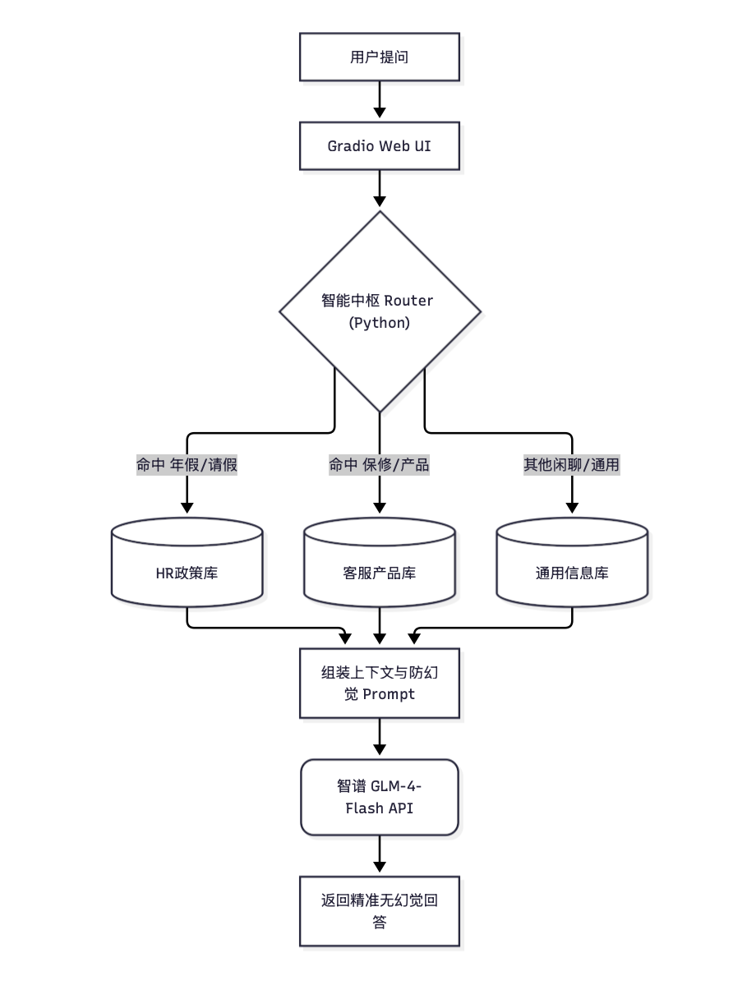

#  企业级智能中枢：多业务线 Modular RAG 系统

基于 LlamaIndex 与云端大模型构建的企业级智能问答中枢。本项目摒弃了传统的“单库线性 RAG”，采用 **多库隔离 + 智能路由分发** 架构，并结合强约束 Prompt，彻底解决了大模型在垂直领域“查不准”与“乱回答（幻觉）”的痛点。

##  核心特性

*   ** 智能路由与多库隔离**：将客服、HR、通用信息独立建库。面对复杂指令，通过 Python 关键字强路由兜底，确保意图识别 100% 精准。
*   ** 高智商云端生成端**：接入智谱 `glm-4-flash` API。通过 `OpenAILike` 接口无缝对接，完美解决本地小模型（0.5B）在长上下文提取时的“过度解释”与“JSON 解析崩塌”问题。
*   ** 严格防幻觉（Grounded Generation）**：定制化中文 Prompt 模板，强制模型只能依据检索到的上下文作答，彻底杜绝脑补。
*   ** 模块化工程规范**：前后端彻底解耦。`app/` 负责 Gradio UI 展示，`src/` 负责核心 RAG 引擎与路由逻辑，具备极高的可扩展性。

##  系统架构图



##  实战效果展示

*( 请将你测试成功的网页截图拖拽到下方)*

### 1. 智能路由与精准应答 (HR 政策库)
*   **用户提问**：我想请年假，怎么申请？
*   **系统响应**：精准识别意图并路由至 HR 库，严格依据文档回答：“请假需提前一天在企业微信提交申请。”

### 2. 踩坑反思与架构演进 (面试核心)
> **为什么放弃了纯本地 0.5B 模型？**
> 在开发初期，本地部署的 Qwen2-0.5B 微调模型在进行复杂路由和长文本提取时，出现了严重的“过度解释”幻觉（如自行脑补企业微信的审批按钮）。这暴露了小参数模型在 Reasoning（推理）和 Instruction Following（指令遵循）上的物理极限。
>
> **工程解法**：架构解耦。本地保留检索层（BGE Embedding + 本地知识库）保障数据隐私；生成端通过 API 接入高智商大模型（GLM-4），业务代码无需改动。实现了算力受限下的降本增效。

##  端侧微调实验 (0.5B LoRA)
*(详细文档见 `finetune_lab` 目录)*
本项目前期完整验证了从 Alpaca 格式数据清洗、LoRA 微调、GGUF 4-bit 量化到 Ollama 本地部署的全流程，沉淀了数万字的踩坑复盘记录。

##  项目目录结构
```text
capstone_project/
├── app/                 # Web UI 服务 (Gradio)
│   └── ui.py            # 前端界面与请求路由
├── src/                 # 核心业务逻辑
│   └── rag_engine.py    # RAG 引擎 (多库索引、智能路由、大模型调用)
├── data/                # 本地知识库数据 (PDF, TXT)
├── docs/                # 架构图与截图
├── finetune_lab/        # 微调与量化实验报告
├── bge-small-zh-v1.5/   # 本地 Embedding 向量模型
└── README.md